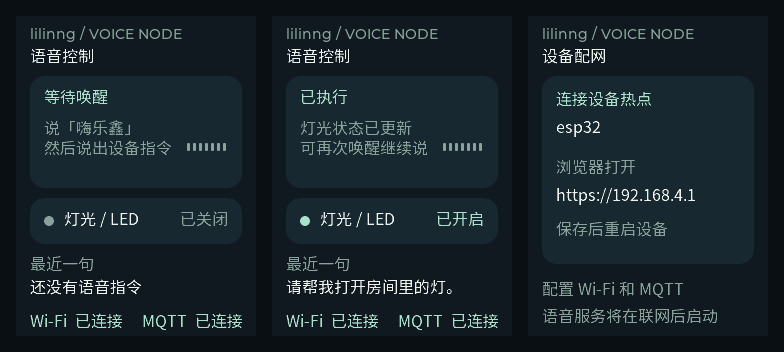

# 语音控制面板

240 × 320 LCD，深色底、青绿色状态提示，不依赖触摸屏。



- 上方：启动、等待唤醒、聆听、识别、理解指令、执行结果或错误提示。
- 中间：板载 LED 的实际软件状态；GPIO 未启用时显示“未启用”。
- 下方：最近识别的一句话，过长省略；Wi-Fi 与 MQTT 的真实连接状态。
- 配网模式：显示设备热点及 `https://192.168.4.1`，不显示保存的 Wi-Fi/MQTT 密码。

没有 Wi-Fi 配置时自动进入配网；已有配置时，开机按住板载按键两秒可进入配网。
错误和执行结果保留到下一次唤醒，不会被 ASR 收尾覆盖。

## MQTT

默认 broker 为 `mqtt://162.14.72.194:1883`。1883 是 EMQX 的默认 MQTT TCP 端口，
Docker 需将该端口映射到宿主机：[EMQX 官方安装说明](https://docs.emqx.com/en/emqx/latest/get-started/deploy/install-docker.html)。

NVS 中原来的示例地址 `47.113.149.47` 会迁移到新地址，缺失地址或非法端口使用默认值。
网页回显同步为生效配置；其他自行保存的 broker 地址、认证信息和主题仍保留，配网页可修改。
本次只配置 broker，MQTT 收到消息后的业务逻辑沿用现有实现。

## 线程和资源

业务任务只更新一份固定大小的状态副本；LVGL 定时器每 150ms 检查变化，有变化才更新控件。
不增加 UI 任务、阴影、常驻动画或网络请求；原来的 LVGL 显示适配归入 `ui` 组件。
讯飞、LLM、音频任务的栈大小和 PSRAM 策略保持上一版设置。

中文字库为思源黑体 16px、2bpp 子集，包含 GB2312 一级常用汉字、界面用字和标点。
字形数据放在 flash，不把完整字体加载到 RAM；生僻字不在此子集中。
字体及转换后的字形使用 [SIL OFL 许可证](../components/ui/fonts/LICENSE.txt)。

正常编译使用已经生成的 `components/ui/fonts/ui_font_chinese_16.c`，不需要 Node.js 或下载字体。
仅重新生成字库时，把 [官方字体](https://raw.githubusercontent.com/adobe-fonts/source-han-sans/release/SubsetOTF/CN/SourceHanSansCN-Regular.otf)
放到 `build/ui-font/SourceHanSansCN-Regular.otf`，再运行 `python tools/generate_ui_font.py`。
生成工具固定使用 `lv_font_conv@1.5.3`。

## 主机预览

预览直接编译相同的 LVGL、页面源文件和中文字库，输出实际帧缓冲 BMP，不模拟 Wi-Fi、GPIO 或麦克风。
在已安装 CMake、Ninja 和 GCC/G++ 的环境运行：

```powershell
cmake -S tools/ui_preview -B build/ui-preview -G Ninja
cmake --build build/ui-preview
Push-Location build/ui-preview
.\ui_preview.exe
Pop-Location
```

预览包含待唤醒、聆听、理解指令、开灯、无匹配、离线错误、配网和页面重建。
设备编译仍使用 ESP-IDF 6.1 专用虚拟环境。

## 本次验证（2026-10-19）

ESP-IDF 6.1 专用虚拟环境编译通过，生成 `build/prj_esp32.bin`，大小 `0x251aa0` 字节，
当前 `0x280000` 应用分区剩余约 185 KiB（7%）。
主机运行上述八种实际 LVGL 场景，确认中文显示、页面切换和控件布局。
经 Serial Workbench MCP 确认 COM8 后烧录，固件哈希校验通过，工作台已恢复串口连接。
板上真实语音“开灯”完成讯飞识别、DeepSeek HTTP 200 和 LED 执行。
用户确认新界面底部 MQTT 显示“已连接”，使用板上原有认证配置。
串口注入本地 JSON 关灯成功，`status` 返回 `led=off queue=0/4`，未额外调用 LLM。
